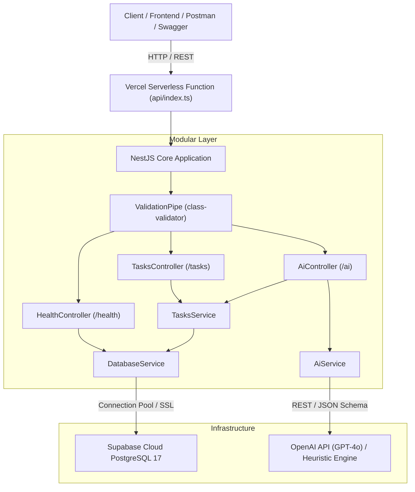

# 🚀 TaskFlow AI REST API

[](https://nestjs.com)
[](https://www.typescriptlang.org/)
[](https://www.postgresql.org/)
[](https://supabase.com/)
[](https://swagger.io/)
[](https://vercel.com/)
[](https://opensource.org/licenses/MIT)

> **Production-grade NestJS REST API** featuring **Supabase PostgreSQL** persistence, full **OpenAPI / Swagger documentation**, **OpenAI-powered task synthesis & entity enrichment**, and automated **cloud telemetry & health monitoring**. Deployed serverless on **Vercel**.

---

## 🌐 Live Deployment & Interactive Docs

* **Live API Base URL**: `https://taskflow-nestjs-api.vercel.app` *(or custom Vercel domain)*
* **Interactive Swagger UI**: [`/docs`](https://taskflow-nestjs-api.vercel.app/docs) or [`/api`](https://taskflow-nestjs-api.vercel.app/api)
* **Cloud Telemetry & Health**: [`/health`](https://taskflow-nestjs-api.vercel.app/health)

---

## 🏗️ Architecture Overview

The application follows NestJS's modular, layered domain-driven architecture with strict inversion of control (IoC), dependency injection, and data validation pipelines:



---

## 🛠️ Tech Stack & Key Design Patterns

| Layer | Technology | Key Capabilities & Highlights |
| :--- | :--- | :--- |
| **Framework** | **NestJS 10** | Modular architecture, Dependency Injection, Global Exception Filters, Validation Pipes |
| **Language** | **TypeScript 5** | Strict type safety, interface segregation, DTO models |
| **Database** | **PostgreSQL 17 (Supabase)** | Cloud hosted, connection pooling, UUID keys, JSONB tags, indexed queries |
| **API Docs** | **OpenAPI / Swagger 3.0** | Auto-generated schema, interactive client, parameter definitions, DTO schemas |
| **AI Integration**| **OpenAI API & NLP Engine** | Task action extraction, priority classification, smart tag recommendation, resilient fallback |
| **Validation** | **class-validator / transformer** | Whitelisted input sanitization, type coercion, non-whitelisted property rejection |
| **Deployment** | **Vercel Serverless** | Zero-downtime serverless function distribution with cached initialization |

---

## 📡 REST API Specifications

### 1. Task Management (`/tasks`)
* `GET /tasks` - Retrieve a paginated list of tasks with filters (`status`, `priority`, `search`, `limit`, `offset`).
* `GET /tasks/:id` - Fetch comprehensive details of a task by UUID.
* `POST /tasks` - Create a new task with validation (`title`, `description`, `priority`, `status`, `tags`).
* `PATCH /tasks/:id` - Partial update of task attributes and enrichment notes.
* `DELETE /tasks/:id` - Hard delete of task record from PostgreSQL.

### 2. AI Intelligence Engine (`/ai`)
* `POST /ai/synthesize` - Takes raw, unorganized text (e.g. meeting notes, email directives) and extracts structured tasks with priority levels, action items, and relevant tags using OpenAI GPT-4o.
* `POST /ai/enrich/:taskId` - Pulls an existing task from Supabase PostgreSQL, generates an executive synthesis and tags, and updates the database row.

### 3. Observability & Health (`/health`)
* `GET /health` - System diagnostics reporting live memory usage (RSS/Heap), uptime, Node runtime version, and real-time database roundtrip latency to Supabase.

---

## 🚀 Local Development Setup

### 1. Prerequisites
* Node.js `>= 18.x`
* npm or pnpm
* Supabase Account & Project

### 2. Clone and Install Dependencies
```bash
git clone https://github.com/deshanFdo/taskflow-nestjs-api.git
cd taskflow-nestjs-api
npm install
```

### 3. Environment Configuration
Create a `.env` file based on `.env.example`:
```env
PORT=3000
NODE_ENV=development
SUPABASE_URL=https://your-project.supabase.co
SUPABASE_SERVICE_ROLE_KEY=your-supabase-service-role-key
OPENAI_API_KEY=your-optional-openai-api-key
```

### 4. Database Schema Setup
Run the following SQL in your Supabase SQL Editor:
```sql
CREATE TABLE IF NOT EXISTS public.tasks (
    id UUID PRIMARY KEY DEFAULT gen_random_uuid(),
    title VARCHAR(255) NOT NULL,
    description TEXT,
    status VARCHAR(50) NOT NULL DEFAULT 'PENDING',
    priority VARCHAR(50) NOT NULL DEFAULT 'MEDIUM',
    ai_summary TEXT,
    tags JSONB DEFAULT '[]'::jsonb,
    created_at TIMESTAMPTZ DEFAULT NOW(),
    updated_at TIMESTAMPTZ DEFAULT NOW()
);
```

### 5. Run the Server
```bash
# Development mode with hot-reload
npm run start:dev

# Production build
npm run build
npm run start:prod
```

Navigate to:
* **API**: `http://localhost:3000`
* **Swagger Docs**: `http://localhost:3000/docs`
* **Health Check**: `http://localhost:3000/health`

---

## 🧪 Clean Coding & Quality Highlights
* **DTO-Driven Validation**: All inputs are validated at runtime before reaching controllers.
* **Resilient AI Pipeline**: The AI service gracefully falls back to a deterministic semantic rule engine if the external OpenAI API key is unset or rate-limited.
* **Separation of Concerns**: Controllers only handle HTTP concerns; services encapsulate business logic and database access.
* **Database Agility**: Direct PostgreSQL integration with Supabase allows high-concurrency connections with low latency.

---

## 📄 License
This project is open-source and licensed under the [MIT License](LICENSE).
